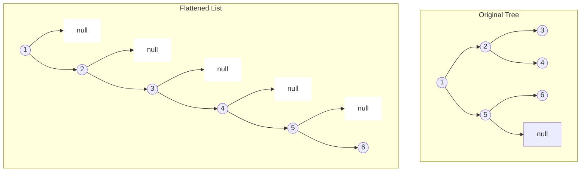

# 114. Flatten Binary Tree to Linked List

## 📝 Problem Description

Given the `root` of a binary tree, flatten the tree into a "linked list":

1. The "linked list" should use the same `TreeNode` class where the `right` child pointer points to the next node in the list and the `left` child pointer is always `null`.
2. The "linked list" should be in the same order as a **pre-order traversal** of the binary tree.

---

## 📐 Visual Representation (Example 1)

### Original Binary Tree vs Flattened Linked List

```text
       Original Tree                  Flattened List
             1                              1
            / \                              \
           2   5                              2
          / \   \                              \
         3   4   6                              3
                                                 \
                                                  4
                                                   \
                                                    5
                                                     \
                                                      6
```

### Interactive Diagram (Mermaid)


---

## 📥 Examples

### Example 1:
- **Input:** `root = [1,2,5,3,4,null,6]`
- **Output:** `[1,null,2,null,3,null,4,null,5,null,6]`

### Example 2:
- **Input:** `root = []`
- **Output:** `[]`

### Example 3:
- **Input:** `root = [0]`
- **Output:** `[0]`

---

## ⚙️ Constraints
- The number of nodes in the tree is in the range `[0, 2000]`.
- `-100 <= Node.val <= 100`

---

## 💡 Solution Approach (O(1) Space - Morris Traversal)

Instead of using recursion or stack space, we can flatten the tree **in-place** using the following steps:
1. For the current node, if it has a **left child**, find its **rightmost node** (predecessor) in the left subtree.
2. Connect that rightmost node's `right` pointer to the current node's `right` subtree.
3. Move the entire left subtree to the right side (`root.right = root.left`).
4. Set the left child to `null` (`root.left = null`).
5. Move to the next right node (`root = root.right`).

### Java Implementation

```java
class Solution {
    public void flatten(TreeNode root) {
        TreeNode curr = root;
        while (curr != null) {
            if (curr.left != null) {
                // Find the rightmost node of the left subtree
                TreeNode prev = curr.left;
                while (prev.right != null) {
                    prev = prev.right;
                }
                
                // Connect the rightmost node to current's right child
                prev.right = curr.right;
                
                // Move left subtree to the right
                curr.right = curr.left;
                curr.left = null;
            }
            // Move to the next node
            curr = curr.right;
        }
    }
}
```

## 📊 Complexity Analysis

- **Time Complexity:** $O(N)$ — Each node is visited at most twice.
- **Space Complexity:** $O(1)$ — No extra recursion stack or memory is used.
